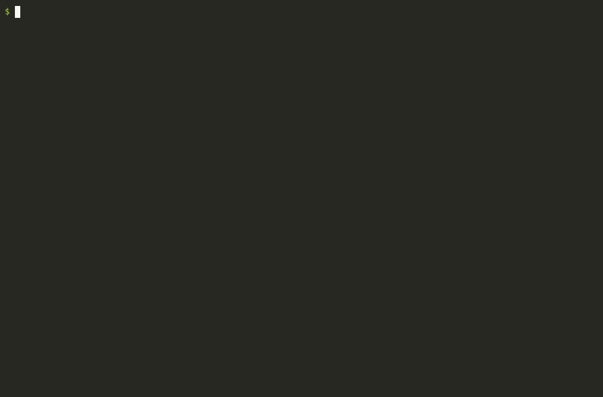
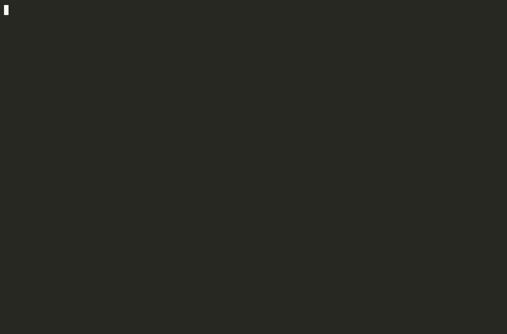

<h1 align="center">booktop</h1>

<p align="center"><b>A live order book in your terminal.</b> Like <code>htop</code>, but for markets.</p>

<p align="center">
  <a href="https://pypi.org/project/booktop/"></a>
  <a href="https://github.com/ArkaKhorchidian/booktop/actions/workflows/ci.yml"></a>
  
  <a href="LICENSE"></a>
</p>

<p align="center">
  
</p>

```bash
uvx booktop          # or: pipx run booktop
```

That's it: no account, no API key, no config. You're watching the real BTC-USD order book,
every quote and every trade, as it happens.

## What you're looking at

- **Depth ladder.** Asks above, bids below, best prices meeting at the spread. The shaded bars are
  *cumulative* size, so the ladder doubles as a depth chart: walls show up as bars that suddenly jump.
- **Flashes.** A size turns yellow the moment it changes, so you can see where the action is.
- **Trade tape.** Every fill, colored by the side that crossed the spread. Unusually large
  trades get a ◆.
- **Book imbalance.** How much resting size sits on the bid versus the ask near the top of the book.
- **Flow.** Aggressive buying versus selling volume over the last 60 seconds.
- **Mid-price sparkline** of the last few minutes.

## Usage

```bash
booktop                      # BTC-USD on Coinbase
booktop ETH                  # any pair: ETH, SOL-USD, DOGE-USD, ...
booktop SOL -x kraken        # Kraken (every book update is checksum-verified)
booktop --demo               # a synthetic market, works offline
```

| Key | |
|---|---|
| `space` | pause |
| `z` | group price levels (1×, 10×, 100×, 1000× the tick) |
| `[` `]` | replay speed |
| `q` | quit |

## Replay a real NASDAQ trading day

<p align="center">
  
</p>

NASDAQ publishes full-depth TotalView-ITCH 5.0 files for free. booktop rebuilds any stock's
order book from one and plays the session back at whatever speed you like:

```bash
pip install "booktop[itch]"
booktop --itch 12302019.NASDAQ_ITCH50.gz AAPL --speed 20
```

Download a day from <https://emi.nasdaq.com/ITCH/Nasdaq%20ITCH/> (a few GB). The first run
indexes the symbol with [fastitch](https://github.com/ArkaKhorchidian/fastitch) and caches it,
so after that, replays start in seconds. Executions are attributed to the aggressor by tracing
each resting order back through its replaces, so the tape colors and the flow gauge reflect
who actually crossed the spread.

## Correctness

- **Kraken:** every book message is checked against the exchange's CRC32 checksum. On a mismatch,
  booktop drops the book and resubscribes, so what you see is never silently wrong. The header
  shows a running count of verified updates.
- **Coinbase:** trades are shown from the aggressor's side (Coinbase reports the maker's).
- Both feeds reconnect automatically with backoff and rebuild from a fresh snapshot.
- Tests replay messages recorded from the real Kraken and Coinbase feeds.

## Install

```bash
pipx install booktop         # or: uv tool install booktop / pip install booktop
```

Python 3.10+, any terminal with true color (most modern ones). Built with
[Textual](https://github.com/Textualize/textual).

## Contributing

Ideas welcome, especially more venues (Binance, Bybit, OKX, Bitstamp), multi-symbol tiling,
a heatmap view of liquidity over time, and order-flow alerts.

```bash
git clone https://github.com/ArkaKhorchidian/booktop && cd booktop
pip install -e ".[test]" && pytest
```

## License

MIT. Not affiliated with Coinbase, Kraken or Nasdaq. Market data is displayed as received
and is not investment advice.
